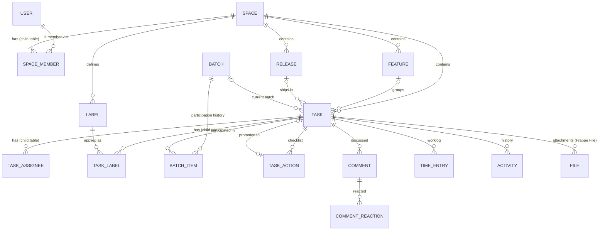
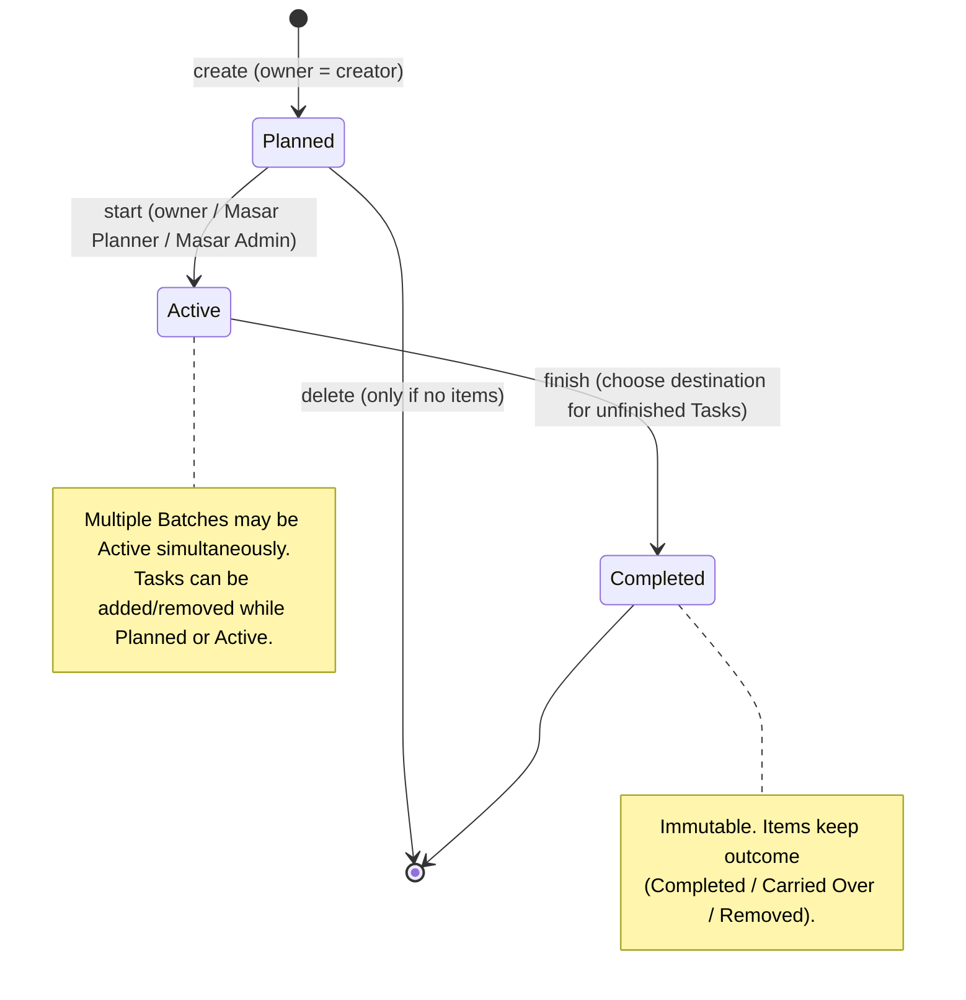

# 02 — Domain & Data Model

Status: **Draft for approval** · Target: Frappe Framework v16 · Last updated: 2026-10-27

This document defines the Masar domain model as Frappe DocTypes: entities, fields, invariants, relationships, permissions, deletion behaviour and transactional boundaries. Requirement IDs refer to [01](01-requirements-analysis.md); decisions refer to [06](06-architecture-decisions.md).

## 1. Modelling principles

1. **Masar owns its data.** All DocTypes live in the `masar` app, module `Masar`, prefixed `Masar ` to avoid collisions with core or other apps. No ERPNext DocType is used.
2. **Child tables only for small, rarely edited collections whose invariants span the whole set** (Space members, Task assignees, Task labels). Frappe rewrites a parent's entire child table on save and deletes rows missing from the payload (VERIFIED, `frappe/model/document.py::update_child_table`), so high-churn collections are standalone DocTypes.
3. **Every row that needs permission filtering carries `space`** (denormalised where needed) so list queries filter on an indexed column rather than joining through parents.
4. **Invariants live in controllers** (`validate`, `before_save`, `on_trash`) so they hold no matter which endpoint writes. Multi-record workflows live in services (`masar/services/*`) that run in one request transaction.
5. **Do not shadow Frappe standard fields.** Frappe's `owner` field is the *creator*; the business "task owner" is therefore `task_owner`. `creation` is the created timestamp; `modified` is the concurrency token.
6. **Random names** (`autoname: hash`) for Task, Action, Comment, Time Entry, Activity and Batch Item. Sequential IDs would leak global volume across Spaces (MASAR-SEC-003). Space, Feature, Release, Batch and Label also use hash names; their titles are display fields.
7. **Soft deletion** only where the history must survive (comments). Elsewhere, deletion is restricted rather than cascaded.

## 2. Entity overview



| Concept (brief §8) | Model decision | Kind |
|---|---|---|
| Space | `Masar Space` | DocType |
| Space membership | `Masar Space Member` | Child table of Space |
| Task | `Masar Task` | DocType |
| Task assignees | `Masar Task Assignee` | Child table of Task |
| Task Actions | `Masar Task Action` | DocType (ADR-004) |
| Feature | `Masar Feature` | DocType |
| Batch | `Masar Batch` | DocType |
| Batch membership / history | `Masar Task.batch` (current) + `Masar Batch Item` (history) | Field + DocType (ADR-012) |
| Release | `Masar Release` | DocType |
| Space labels | `Masar Label` | DocType |
| Task-label assignments | `Masar Task Label` | Child table of Task |
| Important / My Day | `Masar Task.is_important`, `is_my_day` | Fields (ADR-006) |
| Comments | `Masar Comment` | DocType (ADR-005) |
| Reactions | `Masar Comment Reaction` | DocType |
| Worklog entries | `Masar Time Entry` | DocType |
| Activity history | `Masar Activity` | DocType (ADR-005) |
| Attachments | Frappe `File`, private, attached to `Masar Task` | Native reuse (ADR-015) |
| Global roles | `Masar User`, `Masar Admin`, `Masar Planner` | Frappe Role |

## 3. DocType specifications

Field types use Frappe fieldtypes. "Req" = mandatory. "RO" = read-only to clients (set by server only).

### 3.1 Masar Space

**Responsibility:** project-level work context and access boundary. **Record owner:** `space_owner`.

| Field | Type | Req | Default / Allowed | Notes |
|---|---|---|---|---|
| `title` | Data(140) | ✓ | | Unique not required. |
| `category` | Data(140) | | | Free text (client did not define a list). |
| `space_owner` | Link User | ✓ | creator | Must be a Manager row in `members`. |
| `details` | Text Editor | | | Sanitised HTML. |
| `completion_date` | Date | | | Target completion date. |
| `space_type` | Select | ✓ | `Internal` / `External` | |
| `status` | Select | ✓ | `In Progress` (default) / `Completed` / `Cancelled` / `Closed` | Not related to Feature Roadmap. Behaviour per status: Q-06. |
| `department` | Select | ✓ | `ERP` / `App` | |
| `gameplan_url` | Data (URL) | | | Link only; validated as `https://` URL. No sync. |
| `members` | Table → Masar Space Member | ✓ | | ≥ 1 row. |

**Invariants (validate):**

- I-SPACE-1: `members` has unique `user` values.
- I-SPACE-2: at least one row with `role = Manager`.
- I-SPACE-3: `space_owner` appears in `members` with `role = Manager`.
- I-SPACE-4: changes to `members`, `space_owner` only through `space_service` (see §6); generic writes that change them are rejected.
- I-SPACE-5: every member user has the global role `Masar User` and is enabled.

**Indexes:** child table `(user, parent)` index on `tabMasar Space Member` for permission subqueries.
**Deletion:** forbidden if any Task, Feature, Release or Label references the Space; Spaces are retired with `status`. Only `Masar Admin` may delete an empty Space.
**Audit:** `track_changes` on; membership changes additionally written as `Masar Activity` with `reference_doctype = Masar Space`.

#### Masar Space Member (child table)

| Field | Type | Req | Allowed |
|---|---|---|---|
| `user` | Link User | ✓ | |
| `role` | Select | ✓ | `Manager` / `Member` |
| `added_at` | Datetime | RO | |

Why a child table: changes are rare, made by Managers only, and the invariants I-SPACE-1..3 must be evaluated over the whole set atomically. The permission query uses an indexed `EXISTS` subquery on this table.

### 3.2 Masar Task

**Responsibility:** fundamental unit of work. **Record owner:** `task_owner` (business), `owner` (creator, Frappe standard).

| Field | Type | Req | Default / Allowed | Notes |
|---|---|---|---|---|
| `title` | Data(240) | ✓ | | Trimmed; non-empty. |
| `description` | Text Editor | | | Sanitised HTML. |
| `space` | Link Masar Space | ✓ | | Immutable except via `task_service.move_space` (Phase 8+, only if approved). |
| `priority` | Select | ✓ | `Medium`; `Lowest`/`Low`/`Medium`/`High`/`Highest` | |
| `due_date` | Date | | | Date-only (no timezone). |
| `assignees` | Table → Masar Task Assignee | | | Ordered by `idx`. |
| `task_owner` | Link User | | the creator | See I-TASK-2. |
| `feature` | Link Masar Feature | | | Same Space. |
| `release` | Link Masar Release | | | Same Space; Release not Archived. |
| `batch` | Link Masar Batch | | | RO for generic writes; set by `batch_service`. Batch must be Planned or Active. |
| `labels` | Table → Masar Task Label | | | Same-Space labels. |
| `is_important` | Check | | 0 | Shared star attribute. |
| `is_my_day` | Check | | 0 | Shared sun attribute. |
| `is_completed` | Check | | 0 | Completion flag (not a stage). |
| `completed_at` | Datetime | RO | | |
| `completed_by` | Link User | RO | | |
| `remaining_minutes` | Int | | | ≥ 0; optional estimate. |
| `logged_minutes` | Int | RO | 0 | Cached SUM of Time Entries. |
| `action_count` / `action_done_count` | Int | RO | 0 | Cached for list rendering. |
| `comment_count` | Int | RO | 0 | Cached for list rendering. |
| `source_task` | Link Masar Task | RO | | Lineage when created by Action promotion. |
| `source_action` | Link Masar Task Action | RO | | Unique (prevents double promotion at DB level). |
| `client_request_id` | Data(64) | RO | | Idempotency key for inline creation. |
| `sort_order` | Float | | | Manual order within a group (fractional indexing). |

**Invariants:**

- I-TASK-1: `space` exists and the acting user is a member (create) — enforced by permission hook.
- I-TASK-2 (owner, owner decision of 2026-10-31): the creator owns a new Task by default. Nobody is assigned automatically: a new Task (also one promoted from an Action) starts without assignees, and people assign it themselves. Masar never changes the owner on its own: not when assignees are added, removed or reordered, and not when a member leaves the Space. The owner may therefore be someone who is not an assignee (for example the original creator of a Task imported from ERPNext). People change it deliberately with `set_owner`, which accepts a current assignee.
- I-TASK-3: every assignee is a current member of `space`; assignee users are unique.
- I-TASK-4: `feature.space == space`, `release.space == space`, every `labels[].label.space == space` (Q-01/Q-03 defaults).
- I-TASK-5: `is_completed` transitions set/clear `completed_at`, `completed_by` (server time and session user). Clients cannot write those fields.
- I-TASK-6: `batch` is changed only by `batch_service` (it maintains `Masar Batch Item` in the same transaction).
- I-TASK-7: `client_request_id` unique per `owner` (DB unique index `(owner, client_request_id)`).

**Indexes:** `(space, is_completed, modified)`, `(space, feature)`, `(space, release)`, `(batch)`, `(task_owner)`, `(owner, client_request_id)` unique, child `Masar Task Assignee (user, parent)`, `Masar Task Label (label, parent)`, `source_action` unique.
**Deletion:** allowed for the creator or a Space Manager. Cascades in a single transaction: Actions, Comments, Reactions, Time Entries, Activity, Batch Items and attached Files are deleted. A Task that is the `source_task` of others keeps them (their `source_task` is cleared). Deletion is recorded in a Space-level Activity entry (title only).
**Audit:** `Masar Activity` written from `on_update` by diffing `get_doc_before_save()`; `track_changes` off (avoid duplicate history).

#### Masar Task Assignee (child table)

| Field | Type | Req |
|---|---|---|
| `user` | Link User | ✓ |
| `assigned_at` | Datetime | RO |
| `assigned_by` | Link User | RO |

Rationale vs Frappe `ToDo`/`assign_to`: ToDo models personal to-dos, inserts with `ignore_permissions`, and stores assignment in the `_assign` JSON column (VERIFIED, `frappe/desk/form/assign_to.py`), which is unsuitable for indexed filtering and ownership invariants.

#### Masar Task Label (child table)

| Field | Type | Req |
|---|---|---|
| `label` | Link Masar Label | ✓ |

### 3.3 Masar Task Action

**Responsibility:** lightweight checklist item under a Task (ADR-004).

| Field | Type | Req | Notes |
|---|---|---|---|
| `task` | Link Masar Task | ✓ | Immutable. |
| `space` | Link Masar Space | ✓ RO | Copied from task (permission filtering). |
| `title` | Data(240) | ✓ | |
| `is_done` | Check | | |
| `done_at` / `done_by` | Datetime / Link User | RO | |
| `sort_order` | Float | ✓ | Fractional ordering; reorder updates one row. |
| `promoted_task` | Link Masar Task | RO | Set once by promotion; unique. |
| `promoted_at` / `promoted_by` | Datetime / Link User | RO | |

**Invariants:** I-ACT-1 a promoted Action cannot be edited or re-promoted (title locked; completion state is derived from the promoted Task for display). I-ACT-2 `space == task.space`.
**Indexes:** `(task, sort_order)`, `promoted_task` unique.
**Deletion:** creator or Manager; a promoted Action may be deleted (the promoted Task remains, `source_action` cleared).

### 3.4 Masar Label

| Field | Type | Req | Notes |
|---|---|---|---|
| `space` | Link Masar Space | ✓ | Immutable. |
| `label_name` | Data(60) | ✓ | Unique per Space, case-insensitive (stored `label_key` = lower-cased trimmed name with unique index `(space, label_key)`). |
| `color` | Select | ✓ | Fixed palette of Nuxt UI semantic colours (e.g. `neutral`, `primary`, `success`, `warning`, `error`, `info`) plus a few named hues. |

Reserved names `Important` and `My Day` are rejected to avoid confusion with built-in attributes (ADR-006).
**Deletion:** Managers only; removes the label from Tasks (child rows) in the same transaction.

> **Implemented (Phase 4, 2026-10-28).** §3.5 and §3.6 below are the Phase 0 proposal. The differences in the implementation are:
> - no `feature_owner` field;
> - the Task column is `target_release` (`release` is a MariaDB reserved word);
> - Release `release_key` is unique per Space;
> - Archived Releases freeze Task links in both directions and can be restored to Planned or Released;
> - adding Tasks to a Released Release needs no confirmation;
> - deletion requires an explicit detach when Tasks are linked, and is refused for Archived Releases.
>
> See ADR-034 to ADR-040.

### 3.5 Masar Feature

| Field | Type | Req | Default / Allowed |
|---|---|---|---|
| `space` | Link Masar Space | ✓ | Immutable (Q-03 default) |
| `title` | Data(240) | ✓ | |
| `description` | Text Editor | | |
| `roadmap` | Select | ✓ | `Now` / `Next` / `Later` / `Done`; default `Later` |
| `sort_order` | Float | ✓ | Position within its roadmap column |
| `feature_owner` | Link User | | Space member |

**Derived (not stored):** task total / completed counts — computed per request; all Tasks of a Feature are in the same Space, so the counts reveal nothing outside it.
**Indexes:** `(space, roadmap, sort_order)`.
**Deletion:** Managers; Tasks' `feature` cleared in the same transaction.

### 3.6 Masar Release

| Field | Type | Req | Default / Allowed |
|---|---|---|---|
| `space` | Link Masar Space | ✓ | Immutable (Q-01 default) |
| `release_name` | Data(80) | ✓ | e.g. `v2.4.0`; unique per Space |
| `release_date` | Date | | Planned or actual date |
| `status` | Select | ✓ | `Planned` (default) / `Released` / `Archived` |
| `released_at` / `released_by` | Datetime / Link User | RO | |
| `notes` | Text Editor | | Optional description |

**Lifecycle:** Planned ⇄ Released → Archived; Archived → Released (unarchive) allowed for Managers. Archived Releases are hidden from pickers and cannot receive Tasks. Released Releases can still receive Tasks only with an explicit confirmation (late fixes), Q-07.
**Deletion:** Managers; only if no Tasks reference it (otherwise archive).

### 3.7 Masar Batch

> **Implemented (Phase 5, 2026-10-28).** The differences from the proposal below are:
> - status `Finished` instead of `Completed`;
> - no `duration_preset` field (presets compute the end date);
> - start and finish actors and times, `finish_carry` and permlevel-1 request ids / `finish_destination` were added;
> - **no `Masar Task.batch` field**: the current Batch is the Batch Item row with the unique `current_task`;
> - outcomes are `Open / Completed / Carried Over / Returned / Removed`;
> - Batch Item `task` is cleared (history kept) when a Task is deleted.
>
> See ADR-044 and ADR-046 to ADR-050.


**Responsibility:** cross-Space, time-boxed plan (ADR-012).

| Field | Type | Req | Default / Allowed |
|---|---|---|---|
| `batch_name` | Data(140) | ✓ | |
| `start_date` | Date | ✓ | |
| `end_date` | Date | ✓ | `> start_date`; presets set `start + 6` (one week) or `start + 13` (two weeks) |
| `duration_preset` | Select | | `One Week` / `Two Weeks` / `Custom` (UI convenience) |
| `status` | Select | ✓ RO | `Planned` (default) / `Active` / `Completed` |
| `batch_owner` | Link User | ✓ | creator |
| `started_at` / `started_by` | Datetime / Link User | RO | |
| `completed_at` / `completed_by` | Datetime / Link User | RO | |

No `space` field — Batches are intentionally cross-Space. Visibility rules: [04 §5](04-security-permissions.md#5-cross-space-batch-access).

#### Masar Batch Item

**Responsibility:** authoritative record of a Task's participation in a Batch, including history.

| Field | Type | Req | Notes |
|---|---|---|---|
| `batch` | Link Masar Batch | ✓ | |
| `task` | Link Masar Task | ✓ | |
| `space` | Link Masar Space | ✓ RO | Copied from task; used for permission filtering and viewer-scoped aggregation. |
| `is_current` | Check | | 1 while the Task is in this Batch. |
| `added_at` / `added_by` | Datetime / Link User | RO | |
| `removed_at` / `removed_by` | Datetime / Link User | RO | |
| `outcome` | Select | RO | `Open` (while current) / `Completed` / `Carried Over` / `Removed` |
| `completed_in_batch` | Check | RO | Snapshot of `task.is_completed` at Batch finish. |

**Invariants:** I-BI-1 at most one `is_current = 1` row per task (enforced by service + unique index on `(task, current_key)` where `current_key` = `1` when current else the row name). I-BI-2 `task.batch` equals the batch of its current item (or empty). I-BI-3 rows of a Completed Batch are immutable.
**Indexes:** `(batch, is_current, space)`, `(task, is_current)`.



### 3.8 Masar Comment

> **Implemented (Phase 6, 2026-10-28).**
> - **Comment fields:** `author`, `mentions` (validated JSON), `is_deleted`, `deleted_at`/`deleted_by` (content erased on delete), `notified_at` and `client_request_id`.
> - **Related records:** `Masar Comment Reaction` (unique per user and emoji), `Masar Attachment` (Task, optional comment, a private Frappe File, detected type, size) and `Masar Comment Notification` (delivery state per recipient).
>
> See ADR-051 to ADR-056.


| Field | Type | Req | Notes |
|---|---|---|---|
| `task` | Link Masar Task | ✓ | Immutable. |
| `space` | Link Masar Space | ✓ RO | Copied from task. |
| `content` | Text Editor | ✓ | Sanitised HTML; mentions as `<span data-type="mention" data-id="user@x">`. |
| `edited_at` | Datetime | RO | Set on content change. |
| `deleted_at` / `deleted_by` | Datetime / Link User | RO | Soft delete; content blanked on delete. |
| `client_request_id` | Data(64) | RO | Idempotency; unique `(owner, client_request_id)`. |

Author = Frappe `owner`. Ordering = `creation` ascending with `name` as tie-breaker.
Edit history: only `edited_at` is kept (no revision bodies) — PROPOSED; an "edited" marker is shown.
Deleted comments render as "Comment deleted" placeholders so thread context and deep links remain valid.

### 3.9 Masar Comment Reaction

| Field | Type | Req | Notes |
|---|---|---|---|
| `comment` | Link Masar Comment | ✓ | |
| `space` | Link Masar Space | ✓ RO | |
| `user` | Link User | ✓ RO | Session user. |
| `emoji` | Select | ✓ | Curated set: 👍 ❤️ 🎉 😄 👀 ✅ (PROPOSED). |

Unique index `(comment, user, emoji)`; toggle semantics.

### 3.10 Masar Time Entry

As implemented in Phase 7 (ADR-060 to ADR-062; the Phase 0 draft names `user`, `duration_minutes` and `note` were replaced).

| Field | Type | Req | Notes |
|---|---|---|---|
| `task` | Link Masar Task | ✓ | |
| `space` | Link Masar Space | ✓ RO | Copied from the Task; validated to match. |
| `worker` | Link User | ✓ RO | Always the session user. No logging on someone else's behalf. |
| `work_date` | Date | ✓ | A Qatar business date (`Asia/Qatar`). Defaults to Qatar's today; future dates are refused. |
| `minutes` | Int | ✓ | 1 … 1440 per entry. |
| `description` | Small Text | | Optional note, ≤ 1,000 characters. |
| `edited_at` | Datetime | RO | Set by author corrections. |
| `is_voided`, `voided_at`, `voided_by`, `void_reason` | Check / Datetime / Link User / Small Text | RO | A void is kept, not deleted (ADR-061). |
| `client_request_id` | Data(64) | RO | Idempotency; unique together with `owner`. |

**Indexes:** `(task, creation)`, `(task, is_voided)`, `(worker, work_date)`.

**Totals:** every log, correction and void recomputes `task.logged_minutes = SUM(minutes)` over non-voided entries. This runs in the same transaction, under the Task row lock.

**Estimates:** an optional `remaining_minutes` update is applied in the same transaction, conflict-checked against the value the user saw. `Masar Task.has_remaining_estimate` tells "not estimated" apart from "0 left" (ADR-062).

**Deletion:** deleting a Task deletes its time entries.

### 3.11 Masar Activity

| Field | Type | Req | Notes |
|---|---|---|---|
| `reference_doctype` | Select | ✓ | `Masar Task` / `Masar Space` / `Masar Batch` |
| `reference_name` | Dynamic Link | ✓ | |
| `space` | Link Masar Space | | Null only for Batch-level events. |
| `actor` | Link User | ✓ | |
| `event` | Select | ✓ | Allow-list: `created`, `field_changed`, `assigned`, `unassigned`, `owner_changed`, `completed`, `reopened`, `batch_changed`, `label_added`, `label_removed`, `action_promoted`, `promoted_from_action`, `attachment_added`, `attachment_removed`, `comment_deleted`, `member_added`, `member_removed`, `role_changed`, `ownership_transferred`, `batch_started`, `batch_finished` |
| `data` | JSON | | `{field, from, to}` etc. Stores *names* of linked records, never titles from other Spaces. |

Append-only: no update or delete permission for anyone except cascade on parent deletion.
**Indexes:** `(reference_doctype, reference_name, creation)`.

### 3.12 Masar My Day (one day long)

> **Owner decision of 2026-10-31.** `Masar My Day` holds one row per person and Task (unique `(user, task)`), private to that person.
> - My Day lasts one day: `my_day_service.start_new_day` (cron `5 0 * * *`, Asia/Qatar, next to `mark_overdue`) deletes every row and adds the unfinished Tasks due today.
> - A Task that becomes due today during the day (new, due date changed to today, or reopened) joins at once; a person newly assigned to a Task due today gets it too. A person who removes it keeps it removed until the next day.
> - "Its people" are the assignees, or the owner when nobody is assigned; only current, enabled Space members qualify. Finished Tasks leave every My Day (unchanged).

### 3.13 Masar Space File

> **Owner decision of 2026-10-31.** Private Space material (BRDs, customer-provided documents, project files).

| Field | Type | Req | Notes |
|---|---|---|---|
| `space` | Link Masar Space | ✓ RO | |
| `file` | Link File | ✓ | Private Frappe File attached to the Masar Space. |
| `file_url`, `file_name`, `file_size`, `content_type`, `is_image` | | RO | As `Masar Attachment`; the type is detected from the bytes (`attachment_service.detect`). |

Space members list and download them (`file_has_permission` covers Files attached to a Masar Space); Space Managers upload and remove them (Space Settings). The size limit is Frappe's (System Settings → Max File Size). Deleting a Space deletes its files.
**Indexes:** `(space, creation)`.

## 4. Sample records

```json
{
  "doctype": "Masar Task",
  "name": "8f3k2a1q9c",
  "title": "Add VAT field to invoice print",
  "space": "sp-erp-core",
  "priority": "High",
  "due_date": "2026-11-12",
  "assignees": [{"user": "lina@akwad.dev", "idx": 1}, {"user": "omar@akwad.dev", "idx": 2}],
  "task_owner": "lina@akwad.dev",
  "feature": "ft-einvoicing",
  "release": "rl-erp-2-4",
  "batch": "bt-2026-w45",
  "labels": [{"label": "lb-backend"}],
  "is_important": 1,
  "is_my_day": 0,
  "is_completed": 0,
  "remaining_minutes": 240,
  "logged_minutes": 90,
  "modified": "2026-10-27 14:03:11.512331"
}
```

```json
{
  "doctype": "Masar Batch Item",
  "batch": "bt-2026-w44",
  "task": "8f3k2a1q9c",
  "space": "sp-erp-core",
  "is_current": 0,
  "outcome": "Carried Over",
  "completed_in_batch": 0,
  "added_at": "2026-10-20 09:00:00",
  "removed_at": "2026-10-26 17:30:00"
}
```

## 5. Key relationship rules (decision A)

| Relationship | Cardinality | Rule |
|---|---|---|
| Task → Space | exactly 1 | Required, immutable through generic writes. |
| Task → Feature | 0..1 | Same Space. |
| Task → Release | 0..1 | Same Space; Release not Archived. |
| Task → Batch (current) | 0..1 | Batch Planned/Active; may be any Space's planning (Batches are cross-Space). |
| Task → Batch (history) | 0..n | Via Batch Items. |
| Task → Labels | 0..n | Same Space. |
| Task → Assignees | 0..n | Space members; owner rule I-TASK-2. |
| Action → Task | exactly 1 | Promoted Action → 0..1 promoted Task. |
| Feature → Space, Release → Space, Label → Space | exactly 1 | Q-01 / Q-03 defaults. |

## 6. Transactional boundaries

Frappe wraps each HTTP request in one database transaction, committed at the end of a successful request and rolled back on an exception (framework behaviour; to be re-verified in Phase 0 tests). Services therefore perform multi-record work inside a single whitelisted call and never commit manually.

| Operation | Service | Locks | Records touched atomically |
|---|---|---|---|
| Create Task (inline) | `task_service.create` | none (idempotency index) | Task, Activity |
| Update Task fields | `task_service.update` | Task row `FOR UPDATE` | Task, Activity |
| Set assignees / owner | `task_service.set_assignees` | Task row | Task (+ child), Activity |
| Complete / reopen | `task_service.set_completed` | Task row | Task, Activity |
| Promote Action | `action_service.promote` | Action row `FOR UPDATE` | Action, new Task, Activity ×2 |
| Move Tasks to Batch (bulk) | `batch_service.assign_tasks` | each Task row, Batch row | Tasks, Batch Items, Activity |
| Start / finish Batch | `batch_service.start/finish` | Batch row | Batch, Batch Items, Tasks, Activity |
| Remove member | `space_service.remove_member` | Space row | Space (+ child), affected Tasks, Activity |
| Transfer ownership | `space_service.transfer_ownership` | Space row | Space, Activity |
| Log / correct / void time | `time_service.log_time` / `update_entry` / `void_entry` | Task row `FOR UPDATE` | Time Entry, Task (cached total; optional estimate), Activity |
| Post comment | `comment_service.post` | none | Comment, Task (count), then enqueue email after commit |

## 7. Concurrency model

- **Field-scoped optimistic concurrency** for Task edits: the client sends the changed fields plus the value it based each edit on (`base`). The server locks the row, compares the current value of *each changed field* to `base`, and raises `MasarConflictError` (HTTP 409) listing conflicting fields. Edits to different fields by different users therefore never conflict, while overwrites of the same field are always detected. (Frappe's built-in `modified` check, `TimestampMismatchError`, is whole-document and fires on any concurrent change — too coarse for inline editing; it remains active for any generic save.)
- **Child-table edits** (assignees, labels) use dedicated set-style operations (`add_assignee`, `remove_assignee`, `add_label`, `remove_label`) applied server-side to the latest row under lock, so concurrent additions merge instead of overwrite.
- **Ordering** uses fractional `sort_order` values; a move updates only the moved row. Periodic renormalisation runs only when gaps collapse.
- **Counters** (`logged_minutes`, `comment_count`, action counts) are recomputed from source rows under the Task lock, never incremented blindly.

## 8. Deleted and archived records

| Record | Strategy |
|---|---|
| Space | Never cascaded; retire via `status`. |
| Task | Hard delete with cascade (creator/Manager), confirmation required. |
| Comment | Soft delete (placeholder kept). |
| Action | Hard delete. |
| Feature / Label | Hard delete, references cleared. |
| Release | Archive; delete only when unused. |
| Batch | Delete only while Planned and empty; otherwise immutable history. |
| User disabled | Data kept; user appears as "(deactivated)"; removed from pickers. |
