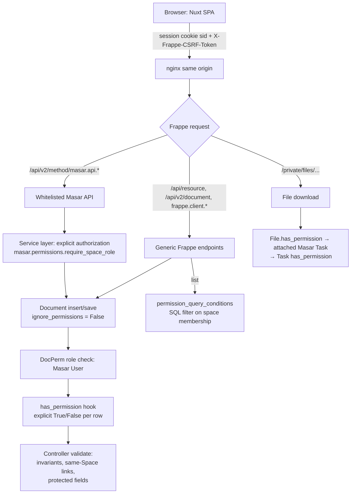

# 04 — Security & Permissions

Status: **Draft for approval** · Target: Frappe v16 · Last updated: 2026-10-27

Space access is the core security boundary of Masar. This document defines the roles, the permission matrix, how each Frappe mechanism is used (and where it is insufficient), cross-Space Batch protection, and the security test catalogue.

Framework facts below are marked **VERIFIED** (read in Frappe `version-16` source) or **UNVERIFIED**; source paths are relative to `github.com/frappe/frappe/blob/version-16/`.

## 1. Roles

### 1.1 Global (Frappe) roles

| Role | Purpose |
|---|---|
| `Masar User` | Gate to the application. Every Masar user has it. Grants DocType-level permissions; row-level access is then decided by Space membership. |
| `Masar Planner` | May start/finish/edit any Batch (Q-02 default). |
| `Masar Admin` | Application administrator: create Spaces (Q-05 default), recover Spaces without Managers, see overall Batch metrics. Not a bypass for task content of Spaces they are not members of, unless also a member (PROPOSED — keeps the "Space access determines visibility" rule absolute; Q-08). |
| `System Manager` | Frappe site administration (users, email, backups). Not used for daily work. |

### 1.1a Interface separation (ADR-023, approved requirement)

| Interface | Who | Enforcement |
|---|---|---|
| **Masar Workspace** (`/`, Nuxt) | Employees, Space Managers, Planners, administrators who also work in Masar | Masar API requires `Masar User`/`Masar Admin`; Space membership decides content |
| **Frappe Desk** (`/desk`, `/app`) | Company-level administrators only (System Manager or other desk roles) | Masar roles have `desk_access = 0` ⇒ holders are Website Users ⇒ Frappe `www/desk.py` returns 403 (VERIFIED v16.54.0) |

A Space Manager is a contextual Space role and **never** grants Desk access. Desk administrators see Masar Spaces in Desk for administration (Space records and membership) but Task content follows Space membership like everyone else (Q-08 default).

### 1.1b Frappe `Administrator` (framework superuser)

Frappe's built-in `Administrator` account is a framework superuser: Frappe grants it every permission, and Masar's hooks deliberately return `True` for it (`_is_superuser`). It is **not** subject to Space membership: it can read and change any Space and Task through Desk, generic APIs and the Workspace. Masar's contextual guarantees ("only members see a Space's content") apply to every other account, including company administrators with System Manager or Masar Admin. The Administrator account must therefore be reserved for system maintenance, its password kept in `/opt/masar/secrets/admin_password`, and it should not be used for daily work. Observed on pre-production (2026-10-28): members were added to the verification Space "E2E Beta" by `Administrator` through the Workspace; this was an authorised superuser action, not a permission defect.

### 1.2 Contextual (per-Space) roles

Stored in `Masar Space Member.role`: **Manager** or **Member**. A user can be Manager in Space A and Member in Space B. A user with no row has no access to the Space or anything in it.

## 2. Permission matrix

> **Phase 3 additions (implemented).** Actions: read by Space members; add/edit/complete/reorder/promote by members while the Space allows task writes (ADR-026); delete by the Action's creator or a Manager. Labels: read/create/apply by members (lifecycle rules apply); rename/recolour/delete by Managers. Bulk operations: per-Task authorisation, all-or-nothing (ADR-031). Generic Frappe writes to Actions and Labels are denied outside Masar services.
>
> **Implemented status (Phase 2, 2026-10-28).** Space-level rows below are enforced by `masar/permissions.py::space_capabilities` (single source used by services and returned to the UI as `permissions`). Differences from the original proposal: Space creation = Masar administrators; Masar administrators manage any Space's details/status/membership without content access; task writes additionally depend on the Space status (ADR-026). Rows for Actions, labels, Features, Releases, comments, attachments, time entries and Batches are implemented in their phases.

Defaults are PROPOSED unless noted; business-level items flagged with their approval question.

| Capability | Member | Manager | Notes |
|---|---|---|---|
| View Space, its Tasks, Features, Releases, Labels | ✓ | ✓ | CONFIRMED (access = visibility) |
| Edit Space details (title, category, dates, type, status, department, Gameplan link) | — | ✓ | |
| Add/remove members, change roles | — | ✓ | Cannot remove/demote the Owner; cannot remove the last Manager |
| Transfer Space ownership | — | Owner only (+ Masar Admin) | New owner must be a Manager |
| Create Space | Q-05 | Q-05 | Default: `Masar Admin` only |
| Delete Space | — | — | `Masar Admin`, only when empty |
| Create Task | ✓ | ✓ | |
| Edit any Task field (title, description, priority, due, Feature, Release, labels, Important, My Day) | ✓ | ✓ | Collaborative team model |
| Assign / unassign users, set task owner | ✓ | ✓ | Only Space members can be assigned |
| Complete / reopen Task | ✓ | ✓ | |
| Delete Task | own (creator) | ✓ | Confirmation dialog |
| Add / edit / complete / reorder / delete Actions | ✓ | ✓ | |
| Promote Action to Task | ✓ | ✓ | |
| Create label | ✓ | ✓ | CONFIRMED ("users may create labels") |
| Rename / recolour / delete label | — | ✓ | |
| Create / edit Feature, move on roadmap | — (P4 implementation) | ✓ | Phase 0 proposed ✓ for Members; Phase 4 implements the directive default (Manager-only), pending a business decision. See ADR-037. |
| Delete Feature | — | ✓ | |
| Create / edit / change status of Release | — | ✓ | |
| Link Task to a Release | ✓ | ✓ | |
| Post comment, react, mention | ✓ | ✓ | |
| Edit own comment / delete own comment | ✓ | ✓ | CONFIRMED |
| Edit others' comments | — | — | Q-04 default |
| Delete (soft) others' comments | — | ✓ | Q-04 default |
| Upload attachments | ✓ | ✓ | |
| Delete attachment | own | ✓ | |
| Log time (own entries) | ✓ | ✓ | |
| Edit / delete own time entries | ✓ | ✓ | |
| Edit / delete others' time entries | — | ✓ | |
| Add own-Space Tasks to a Batch / move between Batches | ✓ | ✓ | Requires Task write access (Q-02) |
| Create Batch | ✓ (any Masar User) | ✓ | Becomes `batch_owner` (Q-02) |
| Edit / start / finish / delete Batch | owner | owner | + `Masar Planner`, `Masar Admin` |

## 3. Enforcement architecture



### 3.1 Mechanisms and how Masar uses them

| Mechanism | Frappe behaviour | Masar usage |
|---|---|---|
| DocType permissions (DocPerm) | Role-based, doctype-level. VERIFIED. | `Masar User` gets read/write/create/delete on Masar DocTypes so that normal `doc.insert()`/`save()` work with permissions *on*. Row-level restriction comes from hooks. `Masar Activity`: read only. |
| `has_permission` hook | `fn(doc, ptype, user, debug)`; called for a specific document; **can only deny**; in v16 a falsy return (including `None`) **denies** (VERIFIED in source and by spike test; v15 treated `None` as "no opinion"). | Implemented for every Masar DocType in `masar/permissions.py`. Always returns an explicit `bool`. Decides by Space membership + ptype + per-capability rules of §2. |
| `permission_query_conditions` | `fn(user, doctype)` → SQL WHERE fragment; applied by `frappe.get_list`, `frappe.client.get_list`, `/api/v2/document` list, `search_link`, report view counts (VERIFIED). **Not** applied by `frappe.get_all` (sets `ignore_permissions=True`, VERIFIED). | One function per DocType restricting rows to `space IN (spaces where user is member)`, using an `EXISTS` subquery on `tabMasar Space Member`. Batch has its own rule (§5). |
| Child table permissions | Access to a child row is decided by the **parent** doc's permission (VERIFIED, `has_child_permission`). | Assignee/Label/Member rows are protected by Task/Space hooks. |
| Document sharing (DocShare) | Shared docs are OR-ed into list queries and "trump all other restrictions" (VERIFIED, `database/query.py`). | **Disabled** for Masar DocTypes: `has_permission` denies `share` ptype and the controller blocks DocShare creation for Masar doctypes via a `DocShare` `before_insert` hook. Test SEC-T13. |
| User Permissions | Restrict by linked record values. | Not used (contextual roles are modelled explicitly). |
| Link validation | Link existence is validated with `frappe.db.get_value` **without** a read-permission check (VERIFIED/INFERRED, `document.py`). | Every controller validates that linked Masar records are in the same Space and readable by the acting user (I-TASK-4). `fetch_from` is not used on cross-record fields. |
| `search_link` | Uses `frappe.get_list` → permission-filtered (VERIFIED). | Masar's pickers use dedicated endpoints (`masar.api.lookup.*`) that are Space-scoped; Frappe's generic link search is not used by the SPA. |
| Whitelisted methods | `@frappe.whitelist(allow_guest=False, methods=[...])` (VERIFIED). | Every Masar endpoint is whitelisted with explicit HTTP methods (`GET` for reads, `POST` for writes) and calls an authorization helper first. No `allow_guest`. |
| `ignore_permissions` | Bypasses DocPerm and hooks. | Allowed only inside services *after* explicit authorization, for system-maintained records (Activity, Batch Items, cached counters). Every use carries a comment naming the check that preceded it. CI greps for new occurrences (review gate). |
| Background jobs | `frappe.enqueue` runs the job as the enqueuing user (VERIFIED, `utils/background_jobs.py`). | Notification jobs re-resolve recipients at send time and re-check each recipient's current membership (§7). |
| Realtime rooms | Joining a doc room calls `frappe.has_permission(..., throw=True)` (VERIFIED, `realtime/handlers.py`); doctype rooms check **doctype-level** permission only (INFERRED). | Masar does not rely on doctype rooms or `list_update` broadcasts for data. Any Masar realtime event is published to **user rooms** of authorised users only, with ids-only payloads (ADR-017). |
| File access | `/private/files` denies Guest; otherwise serves if `has_permission(File, "read")` is true for any File row with that URL; File permission falls back to read permission on `attached_to_doctype/attached_to_name` (VERIFIED, `core/doctype/file/file.py`). | All Masar uploads are private and attached to the Task (also images pasted in comments). Access therefore follows the Task hook and is revoked immediately when membership is removed. |

### 3.2 Generic endpoint posture (ADR-003)

1. The Masar SPA uses **only** `masar.api.*` methods (plus Frappe `login`/`logout` and Masar's upload wrapper).
2. Generic endpoints (`/api/resource`, `/api/v2/document`, `frappe.client.*`) remain reachable — Frappe exposes them for every DocType — so they must be *safe*, not merely unused:
   - reads are filtered by `permission_query_conditions` and `has_permission`;
   - **writes to Masar DocTypes are denied** by `has_permission` unless the request is executing inside a Masar service context (`frappe.flags.masar_service`, a request-local flag that cannot be set by the client). `System Manager` is exempt for administrative repair through Desk, and controllers still enforce invariants for them.
3. Consequently every write goes through a service that performs explicit capability checks, maintains Activity, Batch Items and counters, and returns a consistent contract.

> Verification required in Phase 1 (test SEC-T02/T03): confirm that request-local `frappe.flags` cannot be influenced by request payloads and is reset per request.

### 3.3 Authorization helpers (design)

```text
masar/permissions.py
  get_user_spaces(user) -> set[space]                 # cached per request
  get_space_role(space, user) -> "Manager"|"Member"|None
  require_space_role(space, min_role)                 # raises frappe.DoesNotExistError when no access
  can(user, capability, doc) -> bool                  # single source for §2 matrix
  has_permission_<doctype>(doc, ptype, user, debug) -> bool
  query_conditions_<doctype>(user, doctype) -> str
```

- **No access → 404, not 403.** When the user is not a member of the record's Space, services raise `DoesNotExistError` so that existence is not revealed (MASAR-SEC-004). A member lacking a capability (e.g. Member deleting a label) gets 403 — they already know the record exists.
- The capability matrix is implemented once in `can()` and used by hooks, services and the `permissions` block returned to the frontend (so the UI hides what the server would reject; the UI is never the boundary).

## 4. Authentication and session boundaries (summary)

Detailed in [03 §4](03-system-architecture.md#4-authentication-and-session). Key rules:

- Same-origin deployment; Frappe `sid` cookie (HttpOnly, SameSite=Lax, Secure on HTTPS — VERIFIED in source and observed in the Phase 0 spike).
- CSRF: every POST/PUT/PATCH/DELETE sends `X-Frappe-CSRF-Token` obtained from `masar.api.session.boot`. `ignore_csrf` and `allowed_referrers` are never enabled in production.
- Frappe enforces CSRF only once the session holds a token, which is generated lazily (VERIFIED in spike: header-less POST succeeded before boot, failed with 400 after). Masar write endpoints use `@masar_write`, which requires a session token and a matching header regardless (R-25).
- Logged-out requests receive 403, never 401 (VERIFIED).
- No CORS configuration in production (`allow_cors` unset) — same origin needs none.
- SPA rendering only (`ssr: false`): no server-side Nuxt process holds user sessions, eliminating SSR cross-user data leakage by construction.
- No API keys/secrets in the frontend bundle; token authentication is not used by the SPA.

## 5. Cross-Space Batch access

> **Implemented (Phase 5, 2026-10-28).** §5.1 to §5.3 below are the Phase 0 proposal. The implementation is more restrictive (ADR-043, ADR-045, ADR-049):
> - **Metadata is not visible to all Masar users.** A Batch is visible only to its owner and to members of a Space that has or had Tasks in it.
> - **Authority:** only the owner who manages **every** participating Space can plan, start or finish a Batch. There is no `Masar Planner` role, and no Masar-administrator overall summary.
> - **Finishing:** whoever finishes therefore sees the whole Batch. The destination for unfinished Tasks must be a **Planned** Batch; Active is not allowed.
> - **Generic APIs:** request ids and the finish destination are hidden from generic document reads.


### 5.1 Rules

| Data | Who sees it |
|---|---|
| Batch metadata (name, dates, status, owner) | All `Masar User`s (Q-09 default) — needed so planners and Members can add their Tasks to a Batch. Contains no Space data. |
| Batch Items / Tasks in the Batch | Only rows whose `space` is in the viewer's Spaces. |
| Counts, progress, summaries | Computed **only over viewer-visible items**. Labelled "Your view" when the viewer cannot see every item? **No** — showing that label would itself reveal hidden items. The UI always presents viewer-scoped figures without qualification. |
| Overall (all-Space) metrics | `Masar Admin` only, on a separate endpoint (`batch.overall_summary`). |
| Activity entries on the Batch | Only `batch_started` / `batch_finished` (no Task content). Per-task batch events live on the Task. |
| Search inside a Batch | Through the same viewer-scoped query. |
| Linked titles (Feature, Release names on Task rows) | Same Space as the Task by invariant I-TASK-4, so visible iff the Task is. |

### 5.2 Flow

```mermaid
sequenceDiagram
    participant U as User (member of Space A only)
    participant API as masar.api.batches.get
    participant P as permissions
    participant DB as MariaDB
    U->>API: GET batch bt-45
    API->>P: require Masar User; batch exists?
    API->>P: spaces = get_user_spaces(U) → {A}
    API->>DB: SELECT items WHERE batch=bt-45 AND is_current=1 AND space IN {A}
    API->>DB: SELECT COUNT/SUM ... WHERE batch=bt-45 AND space IN {A}
    DB-->>API: rows/aggregates for Space A only
    API-->>U: {batch metadata, tasks: A-only, progress: A-only}
    Note over U,API: No field reveals that Space B tasks exist:<br/>no "hidden" count, no total, no B titles, no B ids.
```

### 5.3 Finishing a Batch with hidden Tasks

The person finishing a Batch (owner/Planner) may not see every Space. `batch_service.finish` therefore applies the chosen destination to **all** unfinished items server-side; the confirmation dialog shows only the viewer-visible unfinished count, and the server response confirms success without returning hidden counts. The destination Batch must be Planned or Active. History (Batch Items) records the outcome for every item regardless of who finished.

## 6. Comment, mention and attachment access

> **Implemented (Phase 6, 2026-10-28)** with these differences from the proposal below:
> - **Uploads:** through `masar.api.attachments.upload`, with content-signature type detection and a 10 MB default limit; SVG and HTML are refused.
> - **Downloads:** follow **current** Space membership, including for the uploader, via the File permission hook and the `File.is_downloadable` extension. Frappe alone would always allow the uploader.
> - **Caching:** the gateway sends `Cache-Control: private, no-store` on private files.
> - **Mentions:** non-member ids are dropped server-side (the sanitiser removes `data-id`).
> - **Notifications:** ADR-056; the author is included pending Q-P6-1.
>
> See ADR-051 to ADR-056.


- Comment reads are scoped by the Task's Space; deep links (`/tasks/<task>?comment=<id>`) resolve via `masar.api.comments.locate(comment)`, which returns 404 when the user cannot read the Task (same response as a nonexistent comment).
- Mentions: the editor's mention picker lists only current Space members; the server parses mention nodes and **drops** ids that are not current members (no notification, rendered as plain text).
- Attachments: uploaded through `masar.api.files.upload` which checks Task write capability, forces `is_private = 1`, sets `attached_to_doctype = "Masar Task"`, enforces a size limit and an allow-list of MIME types/extensions, and stores the File. Downloads use Frappe's `/private/files` handler, authorised through the File → Task chain.
- File URL sharing caveat: Frappe may reuse a stored file for identical content (UNVERIFIED for v16; to be checked in Phase 6). Even so, `find_file_by_url` authorises when *any* File row with that URL is readable by the requester — that grants access only to bytes the requester could already obtain legitimately, so it is not a cross-Space leak. Recorded as a test (SEC-T09).

## 6a. Time entry access (Phase 7)

| Actor | Read entries and totals | Log | Correct | Void |
|---|---|---|---|---|
| Space Member (In Progress Space) | ✓ | ✓ own | own only | own only (reason optional) |
| Space Manager | ✓ | ✓ own (also in Completed/Cancelled Spaces) | own only | own; **anyone's with a required reason** (provisional, Q-P7-1) |
| Any member, Closed Space | ✓ | ✗ | ✗ | ✗ |
| Outsider / removed member | 404 | 404 | 404 | 404 |
| Generic `/api/resource`, `frappe.client`, `search_link` | filtered lists; 403 on read and write | ✗ | ✗ | ✗ |

Every entry is attributed to the signed-in user (`worker`). Removed members' entries keep their attribution. Totals are computed on the server only (ADR-060, ADR-061).

## 7. Notifications

- Trigger: `comment_service.post` commits the comment, then `frappe.enqueue(..., enqueue_after_commit=True)`.
- Recipients are computed **in the job**, at send time: current Space members, enabled users, minus the author, de-duplicated by email address. Mentioned users get the "mentioned you" subject variant; nobody gets two emails for one comment.
- The job reloads the comment and Task; if either is deleted, or the comment is soft-deleted, it sends nothing.
- Email body contains the Task title, Space title, comment excerpt (sanitised, plain-text rendering) and a deep link. No other Space data.
- Failures: Frappe Email Queue retries; failures are logged against the Comment (`Error Log` with reference); the user action is never blocked by email failure.

## 8. Attack and leak scenarios → protection → test

| # | Scenario | Protection | Test |
|---|---|---|---|
| SEC-T01 | Member requests another Space's Task by ID (`masar.api.tasks.get`, `/api/resource/Masar Task/<id>`, `/api/v2/document/...`) | `has_permission` denies; services raise 404 | P-test: all three paths return 404/403 with no field data |
| SEC-T02 | User edits a Task via `frappe.client.set_value` / `PUT /api/resource` | Generic writes denied outside service context | P-test: 403 and DB unchanged |
| SEC-T03 | Client tries to set `frappe.flags`-like payload keys to bypass | Flags are request-local server state | P-test: payload with `flags`, `__islocal`, `masar_service` has no effect |
| SEC-T04 | Task update references a Feature/Release/Label/Batch from another Space or a non-existent one | Controller same-Space validation; generic Link check insufficient | U-test per link field |
| SEC-T05 | User opens a comment link after losing Space access | `comments.locate` → 404 | P-test after member removal |
| SEC-T06 | Batch with Tasks from Space A and B viewed by A-only member | Viewer-scoped queries | P-test: response contains only A ids; counts equal A counts; payload grep for B ids/titles |
| SEC-T07 | Search endpoints expose inaccessible titles | All lookups Space-scoped | P-test on every lookup endpoint |
| SEC-T08 | Progress summary reveals hidden Spaces | Aggregations filtered by `space IN user_spaces` | P-test compares A-only vs admin overall |
| SEC-T09 | Private file URL still downloadable after membership revoked | File perm → Task perm | E/I-test: 200 before, 403 after removal |
| SEC-T10 | Email/mention to a non-member | Recipients resolved at send time; mentions filtered | I-test with membership change between post and job execution |
| SEC-T11 | Realtime event to unauthorised user | User-room publishing to authorised users only | I-test on publish helper recipient list |
| SEC-T12 | Member edits `space_owner`, `members`, `batch`, `completed_by`, `logged_minutes` | Service-only fields; generic writes denied; services ignore RO fields | P-test |
| SEC-T13 | User shares a Masar Task via DocShare to bypass Space filters | `share` ptype denied; DocShare hook blocks Masar doctypes | P-test |
| SEC-T14 | Member calls a Manager-only service (remove member, delete label, change Release status) | `can()` capability check → 403 | P-test matrix (parametrised over §2) |
| SEC-T15 | `frappe.get_all` or raw SQL used in a user-facing endpoint | Code review gate + CI grep for `get_all(`/`frappe.db.sql(` in `masar/api` | Static check |
| SEC-T16 | Stored XSS through comment or description HTML | Server-side sanitisation (allow-list) + no raw HTML from other sources | U-test with payload corpus |
| SEC-T17 | CSRF: cross-site POST using the user's cookie | SameSite=Lax + CSRF header required | I-test: POST without header fails |
| SEC-T18 | Unauthenticated access | No `allow_guest` methods except login; 401/403 | I-test over all endpoints (route inventory) |
| SEC-T19 | Enumerating Task ids to infer volume | Hash names, 404 for no access | Design review |
| SEC-T20 | Uploading executable / oversized files | Allow-list, size limit, private storage, `Content-Disposition` from Frappe | I-test |

Every test above is a release gate ([08](08-testing-quality.md)).
